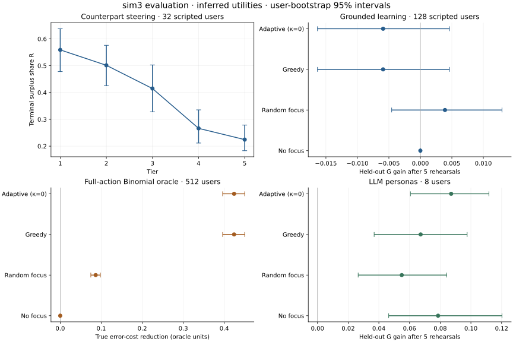

# sim3 virtual-user evaluation

2026-10-28. This experiment evaluates the reimplemented coach on the supplied sim3
negotiation. It does **not establish that the coach improves human negotiation**.

## Main finding

The economic controller produces monotonically harder tiers and obeys its schedule in
all 7,960 primary offline sessions. The adaptive planner does **not** improve held-out
negotiation score in the grounded scripted population: mean gain −0.0059, 95% user-bootstrap
interval [−0.0163, 0.0046]. Abstract Binomial learning experiments improve their own
true-state error-cost objective. These objectives and populations must not be conflated.

The live Anthropic cohort is being completed; its results will be recorded separately.



## Case and assumptions

Source: `data/cases/sim3`, containing 28 supplied Word documents. The local projection
is `data/cases/private/sim3_inferred.json`; both originals and that projection remain
untracked. The user role is the Border Authority Officer. There is no supplied official
point table, numeric walk-away value, or private Mayor sheet. We therefore use an explicitly
inferred finite approximation: six issues, three options each, 729 complete packages.
The Mayor's briefing is inferred from public material only. Each live actor receives only
its own role sheet and the public brief; post-session feedback can label hindsight advice.

**Every numeric utility and both walk-away values are analyst assumptions.** They are not
class grading criteria or a judgment about the value of people. Legal/institutional and
cross-issue feasibility are simplified; the case has no modeled stochastic enforcement
or factual resolution of contradictory public claims. Numerical performance is conditional
on this approximation. The sensitivity analysis changes the assumptions without claiming
to resolve these limits.

[The numeric surrogate](../../results/sim3/numeric_case.json) exposes only invented
utilities and generic option labels, without source text. It reproduces the scripted
experiment's economics; two users × four policies were checked for exact equality to
the primary results. It is **not** a substitute for the source brief in live evaluation.
The private manifest records source hashes; each experiment records its case/source hash.

## Design

| Split / experiment | Independent users | Purpose |
| --- | ---: | --- |
| Cost calibration | 8 | Population costs and focused opportunity rates |
| Development | 64 | Choose forgetting λ and uncertainty bonus κ |
| Exact Binomial test | 512 | Known-state learning and posterior diagnostics |
| Steering | 32 | Paired tier and focus comparisons |
| Grounded recovery | 64 | Five sessions, then 30 independent reference sessions |
| Grounded learning | 128 | Four policies, five rehearsals each |
| Utility sensitivity | 64 per variant | Four alternative inferred score tables |
| Live LLM test | 8 planned | Same four-policy training/probe design |

Random errors, awareness and rapport start from Beta(2,2). Each error response δ has a
15% mass at zero; otherwise it is uniform on [0.2,0.65]. For scripted learners, a focused
error's propensity is multiplied by 1−δ. Fact or rapport practice removes 30% of the
corresponding deficit; this is an experimental assumption. LLM personas instead receive
actual preparation callouts and previous coaching: their tendencies are not manually
improved. Neither population is calibrated to human behavior.

Training uses tiers (2,2,4,4,4). G is the average terminal surplus share over held-out
tiers (1,3,5), with no focus, hook or new feedback during the probes. Both before and
after probes use the same fixed seed per scripted user. The case is shared with training:
this is **tier generalization within sim3**, not held-out-case generalization. Prior
coaching remains in LLM users' memory during post-training probes. No-focus still receives
a post-session report; it is a no-targeting control, not a no-feedback control.

All comparisons pair the same sampled user across policies. Intervals use 2,000 bootstrap
resamples of users, not independent resamples of their turns. LLM sampling is not seedable;
paired personas reduce heterogeneity but do not supply identical model randomness.
Development selected λ=0.5 and κ=0. Thus the tuned adaptive rule **equals greedy** on the
same observations. This experiment cannot establish an advantage from an uncertainty bonus.
The grid was tuned on the error-only oracle; the full-action diagnostic and grounded/live
tests retain that tuning without inspecting their test results.

## ML-Q1: steering

| Tier | Mean R | 95% interval | Agreement rate |
| --- | ---: | --- | ---: |
| 1 | 0.559 | [0.478, 0.638] | 100% |
| 2 | 0.501 | [0.425, 0.576] | 100% |
| 3 | 0.415 | [0.328, 0.503] | 100% |
| 4 | 0.266 | [0.212, 0.335] | 100% |
| 5 | 0.224 | [0.183, 0.278] | 100% |

Spearman correlation between tier and mean R is −1. This demonstrates tier ordering in
this population, not human realism. All 7,960 primary offline episodes had zero counted
schedule violations. A high agreement rate alone does not show that bargaining is realistic.

Focus steering is mixed. Accepting-low opportunities increased by 0.188/user
[0.031, 0.344], while logical-error opportunities decreased by 2.156 [−3.781, −0.875].
Conceding-first, unreciprocated-concession and anchoring opportunity differences included
zero. Ignoring-issue opportunities are six per completed annotated session by definition;
the hook cannot increase that fixed count. Fact/rapport opportunities count turns, so
revealing information does not necessarily increase their opportunity count either.

These are failures/limits of the proposed opportunity-uplift criterion, not grounds to
change detector definitions after seeing results. The package hooks log availability;
`hook_application_rate=0` in the original steering artifact for other hooks means **no
package-hook telemetry**, not a 0% implementation rate. New runs report null for that case.

## ML-Q2: inference

The scripted policy's Bernoulli knobs attempt actions but are **not** guaranteed to equal
conditional detector probabilities. Overlap, acceptance, feasibility and observed opponent
movement couple behavior. Grounded recovery therefore compares posteriors with empirical
rates from 30 additional no-focus sessions per user, not with the knobs as if they were θ.

| Error | RMSE vs reference | 95% interval coverage of reference | Knob vs realized Spearman |
| --- | ---: | ---: | ---: |
| Conceding first | 0.249 | 92.2% | 0.115 |
| Unreciprocated concession | 0.331 | 65.6% | 0.279 |
| Anchoring | 0.239 | 90.6% | 0.879 |
| Accepting low | 0.237 | 93.8% | 0.789 |
| Ignoring an issue | 0.095 | 98.4% | 0.987 |
| Dominated offer | 0.159 | 82.8% | 0.341 |

The unreciprocated-concession posterior is especially poorly calibrated. Ignoring-issue
estimates are more informative. Rapport coverage of the Monte Carlo reference is 78.1%,
with RMSE 0.135. Asking about interests also counts as rapport, so the raw rapport knob
cannot be interpreted independently of awareness in this policy.

[Expanded diagnostics](../../results/sim3/validation/recovery_all.json) include every fact,
rapport, split-half correlations, and AUC against reference rate ≥0.5. AUC can be undefined
or unstable when one class is absent/rare; it is not evidence of accuracy in that case.
Reference rates themselves have Monte Carlo error, so the coverage numbers are diagnostics,
not exact frequentist coverage against known truth. Human tagging agreement is unmeasured.

In the separate error-only Binomial oracle, the adaptive posterior has MSE 0.0311 and
96.8% empirical coverage. Discounting the prior as in report.tex instead gives MSE 0.0456
and 95.2% coverage. This supports separating the two recursions, not claiming universally
calibrated uncertainty from synthetic oracle success.

## ML-Q3: planning and held-out competence

| Policy | Grounded G gain, 128 users | 95% interval |
| --- | ---: | --- |
| Adaptive (κ=0) | −0.00592 | [−0.01634, 0.00462] |
| Greedy | −0.00592 | [−0.01634, 0.00462] |
| Random focus | 0.00391 | [−0.00456, 0.01296] |
| No focus | 0 | [0, 0] |

Adaptive minus random is −0.00982 [−0.02243, 0.00219]. Baseline G is 0.3677. The zero
no-focus gain is expected from the stipulated synthetic Learn rule and paired seeds; it
is not an empirical estimate of how real users learn without targeting. The adaptive
policy spent 347/640 rehearsals on the welfare-priority fact. Estimated fact costs and
opportunity frequency can dominate error-focused practice. Credit is associated with all
co-occurring deficits, so these costs must not be interpreted as isolated causal effects.

The error-only exact oracle produces true weighted error-cost reductions of 0.5893
[0.5604,0.6157] for adaptive/greedy versus 0.3238 [0.3044,0.3435] for random. With all
27 error/fact/rapport actions available, the corresponding reductions are 0.4240
[0.3960,0.4499] versus 0.0864 [0.0746,0.0979]. No-focus is zero. Oracle rewards use
actual planted probabilities, never posterior changes, and are **not G gains**.

No error-only oracle user reached the all-six-errors-below-0.25 threshold within five
rehearsals. Sessions-to-threshold is right-censored at 6 for all users; therefore this
study provides no evidence for faster complete mastery under that demanding endpoint.

### Sensitivity to inferred economics

Costs and tuning remain fixed at primary calibration; 64 matched users per variant.
Walk-away shifts are ±10% of each role's own range. Two independent log-normal issue
weight perturbations (σ=0.2) preserve each role's maximum points.

| Assumption change | Adaptive G gain | 95% interval |
| --- | ---: | --- |
| Lower walk-aways | −0.00900 | [−0.02197, 0.00322] |
| Higher walk-aways | 0.00258 | [−0.01131, 0.01645] |
| Issue weights, draw 1 | −0.00647 | [−0.02440, 0.00924] |
| Issue weights, draw 2 | −0.02184 | [−0.04394, −0.00106] |

There is no demonstrated adaptive gain under these changes, and one variant is harmful.
These are exploratory, unadjusted intervals; they do not cover every plausible scoring
model or establish robustness beyond the tested perturbations.

## Counterfactual validity

Twelve independent steering sessions supplied 26 critical-turn estimates. Compared with
M=16, M=4 had rank correlation 0.839, mean absolute difference 0.0198 R, and 96.2% sign
agreement; M=5 gave 0.863, 0.0177 R, and 96.2%. Both selection and scoring use separate
seeds; actual and selected moves share fresh scoring seeds. Negative deltas are retained.

All 12 planted early acceptances had positive estimated loss (mean 0.290 R,
[0.239,0.341]); all nine with competing critical turns ranked first. The three single-turn
cases provide no ranking discrimination. M=16 is still a model-based Monte Carlo reference,
not ground truth, and no teammate face-validity ratings have been collected. M=4 remains
an exploratory latency/cost choice rather than a precision guarantee.

## Reproduction

Run from the project directory with the existing virtual environment. No API calls occur
in the first three commands. Exact original case/source hashes require the private case;
the numeric surrogate gives reproducible offline economics under a different case hash.

```bash
python scripts/evaluate.py --case results/sim3/numeric_case.json \
  --output results/sim3/reproduction --users 128 --calibration-users 8 \
  --steering-users 32 --recovery-users 64 --reference-sessions 30 \
  --oracle-users 512 --development-users 64
python scripts/validate_evaluation.py
python scripts/oracle_action_space.py
python scripts/report_evaluation.py
```

The live command sends the private fictional role material to Anthropic and costs money;
the user explicitly authorized it for this evaluation:

```bash
python scripts/evaluate.py --live --stage training --users 8 --workers 4 \
  --calibration-from results/sim3/offline-v1 --output results/sim3/live-v1
```

Full-context reservations in `.api-budget.sqlite3` enforce the cumulative $150 cap. Never
delete/reset the ledger to resume. Raw private transcripts are checkpointed after every
turn in ignored `raw/` directories. Public outputs contain numeric observations, seeds,
configuration, model names and source hashes. Runtime repairs are recorded in
`live-v1/runtime_revisions.json`; an explicit `--resume-note` is required to preserve an
existing cohort across a source-code change. SDK retries/model fallback are disabled;
one separately reserved retry is allowed for a known truncated structured response.

## What remains unestablished

Human transfer, a human-like concession curve, teammate tag agreement, broader case
transfer, an advantage of κ>0, and reliable mastery within five rehearsals are unestablished.
Human-vs-human study infrastructure/recruitment and participant studies remain future
project tasks. Simulation evidence cannot mark those tasks complete. The implementation
and experiment report preserve these negative and missing results rather than claiming
the research hypothesis has been proven.
